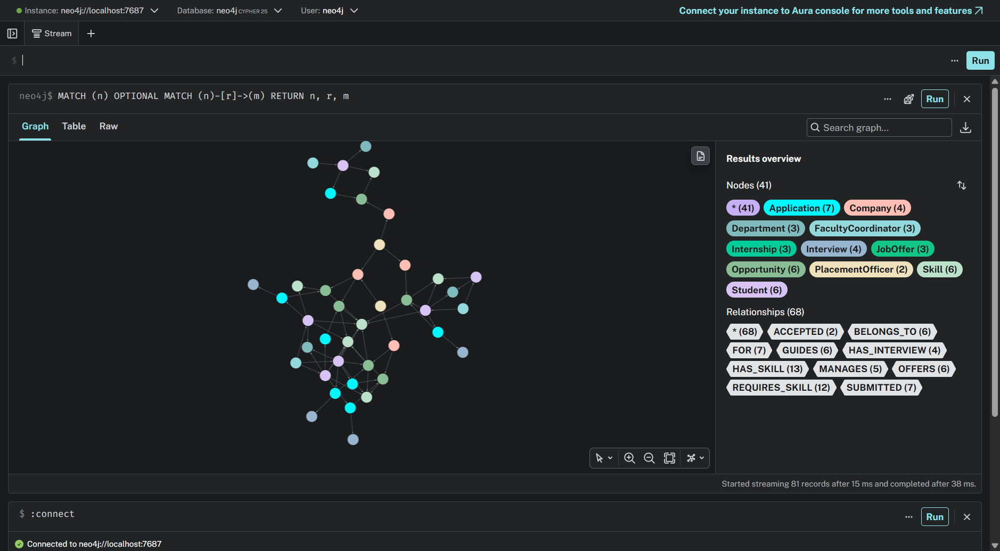
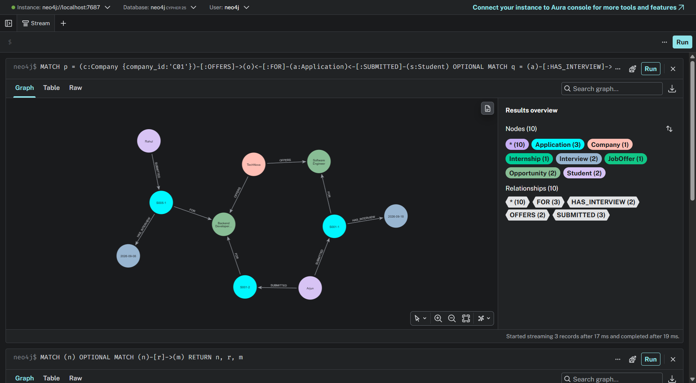
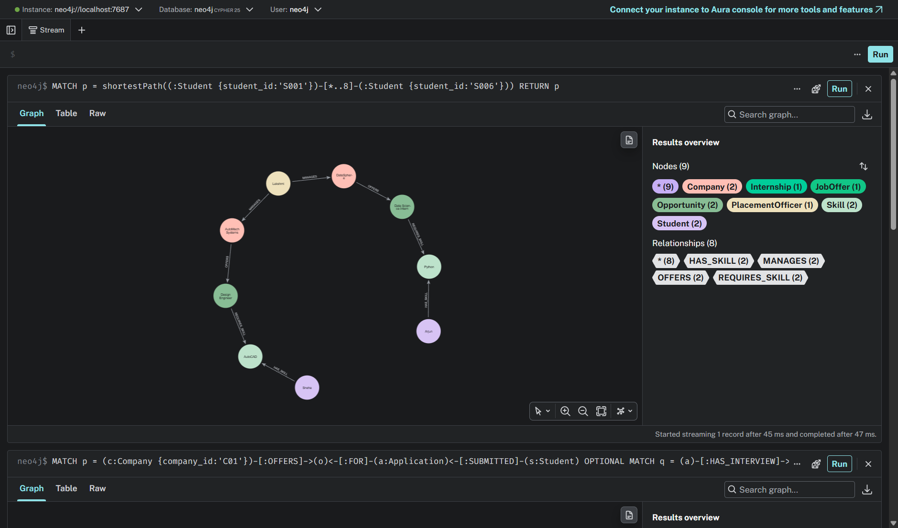

# Internship and Placement Management System — Neo4j (DA3)

Cypher implementation of the DA3 report: 9 node labels, 10 relationship types, 41 sample nodes.

## Screenshots

Taken from Neo4j Browser, running the queries in `04_graph_queries.cypher` on the sample data.

**The whole graph (E9)** — 41 nodes, 68 relationships, 10 relationship types.



**Company network (E8)** — TechNova's opportunities, the applications for them, the students who
applied and their interviews.



**Shortest path (E3b)** — how a Computer Science student and a Mechanical student are connected.



## Running it locally

Tested on Neo4j Community 2026.10.1.

1. Download Neo4j Community Edition and unzip it into a `neo4j-server/` folder here
   (that folder is not part of this repository).
2. Set your own password before the first start: `bin\neo4j-admin.bat dbms set-initial-password <your-password>`.
3. Double-click `start_neo4j.bat` and keep its window open.
4. Open <http://localhost:7474> and connect to `neo4j://localhost:7687` as user `neo4j` with your password.
5. Paste queries from the `.cypher` files into the editor. Path queries (E3, E8, E9) show as a graph picture.

The `results/` folder holds the text output of every script from a test run.

## How to run (Neo4j Aura or the local server)

1. Open your Aura instance → **Query** (or the local browser above).
2. Paste and run the files in this order:

| Order | File | What it does |
|---|---|---|
| 1 | `01_constraints.cypher` | 9 uniqueness constraints (primary keys) |
| 2 | `02_load_data.cypher` | Loads the sample data; ends with two count checks |
| 3 | `03_crud.cypher` | Create / Read / Update / Delete examples |
| 4 | `04_graph_queries.cypher` | Graph queries E1–E9 |

Files 1 and 2 can be pasted whole (statements are separated by `;`). For files 3 and 4, run one
statement at a time so each result can be screenshotted.

After file 2 the checks should show **41 nodes** (Internship and JobOffer are sub-labels of the
6 Opportunity nodes, so do not add them again) and **10 relationship types**.

## Starting over

`03_crud.cypher` changes the data (adds S007, deletes application S005-2). To return to the
original dataset, clear the database and re-run file 2:

```cypher
MATCH (n) DETACH DELETE n;
```

## Graph model

| Relationship | From → To | Replaces (DA2) |
|---|---|---|
| `BELONGS_TO` | Student → Department | Dept_ID foreign key |
| `GUIDES` | FacultyCoordinator → Student | Faculty_ID foreign key |
| `MANAGES` | PlacementOfficer → Company | MANAGES junction table |
| `OFFERS` | Company → Opportunity | OFFERS / PROVIDES |
| `HAS_SKILL` | Student → Skill | STUDENT_SKILLS table |
| `REQUIRES_SKILL` | Opportunity → Skill | INTERNSHIP_SKILLS table |
| `SUBMITTED` | Student → Application | Student_ID in APPLICATION |
| `FOR` | Application → Opportunity | nullable Internship_ID / Offer_ID |
| `HAS_INTERVIEW` | Application → Interview | App_ID in INTERVIEW |
| `ACCEPTED {offer_accepted_date}` | Student → Opportunity | RECEIVES + Offer_Accepted_Date |

## Sample data at a glance

| Student | Dept | Skills | Applications |
|---|---|---|---|
| S001 Arjun | Computer Science | Java, SQL, Python | S001-1 → O04 (Selected, accepted), S001-2 → O01 |
| S002 Priya | Computer Science | Python, Machine Learning, SQL | S002-1 → O02 (interview pending) |
| S003 Karthik | Electronics | Embedded C, Python | S003-1 → O03 (Selected, accepted) |
| S004 Divya | Electronics | Embedded C | none |
| S005 Rahul | Computer Science | Java, Python, SQL | S005-1 → O01 (Rejected), S005-2 → O05 |
| S006 Sneha | Mechanical | AutoCAD | S006-1 → O06 |

| Opportunity | Type | Company | Required skills |
|---|---|---|---|
| O01 Backend Developer Intern | Internship | TechNova (C01) | Java, SQL |
| O02 Data Science Intern | Internship | DataSphere (C02) | Python, Machine Learning |
| O03 Embedded Systems Intern | Internship | GreenGrid Energy (C03) | Embedded C, Python |
| O04 Software Engineer | JobOffer | TechNova (C01) | Java, Python, SQL |
| O05 Data Analyst | JobOffer | DataSphere (C02) | SQL, Python |
| O06 Design Engineer | JobOffer | AutoMech Systems (C04) | AutoCAD |
